# Forschungsprojekt KI-Zoom – wie die Kamera funktioniert

*Stand: Version 1.1 · 15.11.2026 · Idee und Richtung: John · Umsetzung mit Claude*

Dieses Dokument erklärt in verständlicher Sprache, was die App mit einem Foto macht,
warum sie es so macht und was wir dabei gelernt haben. Es wird mit jeder Version
fortgeschrieben und hängt jeder Version als lesbare Datei an.

---

## 1. Die Ausgangslage

Das Poco X7 Pro hat keinen optischen Zoom. Wer „heranzoomt“, schneidet nur einen Teil
aus dem Sensorbild aus – bei 8× bleibt etwa ein Sechzigstel der Pixel übrig. Ziel des
Projekts: aus diesem kleinen Ausschnitt so viel **echtes** Detail wie möglich
herausholen, statt es nur hübsch zu erfinden.

### Was das Handy freigibt (Messung mit „Check“)
- Höchste Freigabestufe (LEVEL 3), RAW-Daten, manuelle Belichtung, Serienbilder
- Hauptsensor eigentlich 50 MP, freigegeben werden nur 12,6 MP (je 4 Pixel zusammengefasst)
- Versteckte Kameras: Ultraweitwinkel und eine logische Mehrfachkamera, die normalen Apps nicht gemeldet werden

---

## 2. Die Rechenkette (Version 1.8)

Ein Druck auf den Auslöser löst diese Schritte aus:

### Schritt 1 – Scharfstellen mit eigenem Autofokus
Xiaomis Autofokus bevorzugt das nächste Objekt. Deshalb fährt die App den Fokus selbst
von „fern“ bis „nah“ durch und misst dabei die **Schärfe nur im Fokusrahmen**
(Kontrast = Summe der Helligkeitssprünge). Die beste Entfernung wird festgehalten und
alle 5 Sekunden fein nachgeprüft. Der Rahmen verfolgt das Objekt per Bildvergleich.

### Schritt 2 – Bildserie
Bis zu 30 Bilder als **RAW** (rohe Sensordaten, unbearbeitet) plus bis zu 10 normale
Kamerabilder (für Farbe und Helligkeit). Die Kamera-eigene Schärfung und Rauschminderung
ist ausgeschaltet, damit nichts verfälscht wird.

### Schritt 3 – Lagesensor
Während der Serie misst das Gyroskop, wie stark die Hand sich dreht. Daraus folgt für
jedes Bild die **Verwacklung in Pixeln**:
> Verwacklung = Drehgeschwindigkeit × Belichtungszeit × Brennweite in Pixeln

Verwackelte Bilder zählen weniger, stark verwackelte werden aussortiert.

### Schritt 4 – Mehrbild-Superauflösung
Die Hand zittert immer ein wenig. Dadurch liegt jedes Bild um Bruchteile eines Pixels
versetzt. Die App
1. richtet alle Bilder aufeinander aus – erst als Ganzes, dann **kachelweise**
   (gleicht auch leichte Drehungen aus; bewegte Stellen zählen weniger),
2. verteilt **jeden einzelnen Farbpunkt** des Sensors an seiner exakten Position auf
   ein bis zu doppelt so feines Raster.

So entsteht echtes zusätzliches Detail – das gleiche Prinzip wie bei Googles Pixel-Kameras.
Helligkeit und Farbe werden danach an das normale Kamerabild angeglichen.

### Schritt 5 – Unschärfe messen
An den kräftigsten Kanten wird gemessen, wie breit ein Hell-Dunkel-Übergang verschmiert ist:
> Ein scharfer Sprung der Höhe A wird durch Unschärfe σ zu einer Rampe mit
> maximaler Steigung A / (σ · √2π). Aus Höhe und Steigung folgt σ.

- **Schrift als Eichmaß (Johns Idee):** Eine Texterkennung auf dem Gerät sucht Buchstaben.
  Gedruckte Schrift ist schwarz-weiß, ihre Kanten sind echte Sprünge – ideal zum Messen.
  Die Buchstaben selbst werden **nicht** verändert.
- **Je Richtung:** Senkrechte Kanten verraten die waagerechte Unschärfe und umgekehrt –
  so wird einseitige Verwacklung erkannt.
- **Je Bereich:** Das Bild wird in 6 Felder geteilt. Bei einem ebenen Motiv (Karton,
  Fassade) müssen alle gleich scharf sein. Ist ein Feld deutlich unschärfer, meldet die
  App das – es deutet auf einen Rechenfehler hin, nicht auf die Optik.

### Schritt 6 – Kameramodell (Physik)
Die App berechnet, wie unscharf das Bild **mindestens** sein muss:

| Quelle | Formel | Größenordnung |
|---|---|---|
| Beugung an der Blende | σ ≈ 0,42 · λ · Blende (λ = 0,55 µm) | ≈ 0,2 Pixel |
| Pixelfläche | σ = 1/√12 Pixel | 0,29 Pixel |
| Mehrbild-Raster | Verteilkern | ≈ 0,35 Pixel |
| Verwacklung | Strecke / √12 | je nach Hand |
| Objektivfehler | Annahme | ≈ 0,4 Pixel |

Die Quellen addieren sich quadratisch. Die gemessene Unschärfe wird auf den Bereich
zwischen diesem Minimum und „Minimum + 2,5 Pixel“ begrenzt – was außerhalb liegt, ist
physikalisch unplausibel und wohl ein Messfehler.

### Schritt 6b – Schärfeprofil des eigenen Objektivs (Kalibrierung)
Liegt eine Kalibrierung vor (siehe Abschnitt 3), weiß die App, wie unscharf **dieses**
Objektiv an jeder Stelle des Sensors abbildet – die Ecken sind fast immer weicher als
die Mitte. Für jede Kachel des Bildes wird die Unschärfe dann so zusammengesetzt:
> σ² = σ²(Profil an dieser Stelle) + σ²(Zusatz dieses Fotos)

Der Zusatz (Fokus-Restfehler, Verwacklung) ist das, was das Foto über das Profil hinaus
unscharf ist – gemessen an der Bildmitte.

### Schritt 7 – Physikalisch entschärfen
Mit der gemessenen Unschärfe wird das Bild **zurückgerechnet** (Richardson-Lucy-Verfahren):
> „Wenn mein geschätztes scharfes Bild mit dieser Unschärfe verwischt würde – stimmt es
> dann mit dem Foto überein?“ – und die Schätzung wird so lange korrigiert, bis es passt.

Ein **Kantenschutz** verhindert Lichthöfe und Ringe. Das Verfahren erfindet nichts: Es
holt nur zurück, was im Bild gedämpft noch vorhanden ist. Gerechnet wird in Kacheln
auf allen Prozessorkernen, mit Zeitbudget (schnell ≈ 25 s, stark ≈ 60 s).

### Schritt 8 – KI, nur noch sanft
Ein KI-Modell (Real-ESRGAN, frei nutzbar, läuft komplett auf dem Handy) rekonstruiert
feine Kanten. Weil die KI **erfindet**, was sie für plausibel hält, wird sie
standardmäßig nur zu **30 %** untergemischt. In der Bildansicht lässt sich stufenlos
zwischen „Echt“ (0 %) und „KI“ (100 %) wählen.

---

## 3. Kalibrierung mit Testmuster (ab Version 1.1)

**Idee (John):** Statt die Unschärfe in jedem Foto nur zu schätzen, misst die App einmal
genau, wie das eigene Objektiv abbildet – ein „Schärfeprofil“.

**Ablauf:** Das iPad zeigt eine Testmuster-Seite (Link per QR-Code in der App, *Mehr ›
Kalibrieren*). Das Handy fotografiert das Muster aus etwa 1,5 m bei 2× Zoom an fünf
Stellen des Bildes (Mitte, vier Ecken) und zum Schluss eine Graustufen-Treppe.
Vor jeder Aufnahme stellt die App selbst auf die Rahmenmitte scharf.

**Warum das iPad-Display nicht stört:** Aus 1,5 m sieht ein Kamerapixel etwa fünf
iPad-Pixel – das Pixelraster des Displays verschwimmt vollständig, jede Kante ist für die
Kamera ein perfekter Sprung. Gemessen wird nur die *Breite* des Übergangs, nicht die
absolute Helligkeit; Farbstich oder leichte Spiegelung verfälschen das kaum.

**Was gemessen wird:**

| Muster | Messung | Wozu |
|---|---|---|
| Schräge schwarze Quadrate | Unschärfe σ je **Farbe** (R, G, B) und **Richtung** (x, y), in den linearen RAW-Daten | Schärfeprofil über den Sensor; Farben zeigen, ob das Objektiv Rot und Blau anders abbildet als Grün |
| 11 Graustufen in gleichen Lichtschritten | Gerade durch Messwert ↔ Licht | **Linearität** des Sensors (Voraussetzung für Mehrbild und Entschärfen) und **Streulicht** (Rest-Helligkeit bei Schwarz) |

Schwarz-weiße Kanten genügen für die Farbmessung: An jeder Kante springt jeder der drei
Farbkanäle – so wird jede Farbe an exakt derselben Kante vermessen.

Die Verwacklung während der Kalibrier-Aufnahme (Lagesensor) wird herausgerechnet.
Das Profil wird auf dem Handy gespeichert; zwischen den fünf Messpunkten wird nach
Abstand gewichtet interpoliert.

**Messfehler der Kantenmessung entdeckt und korrigiert:** Beim Testen mit bekannter
Unschärfe zeigte sich, dass die Steigungsmessung (Differenz über 2 Pixel) jede Kante um
eine feste Varianz von ≈ 0,5 px² verbreitert. Seit Version 1.1 wird das herausgerechnet:
> σ = √(σ²gemessen − 0,5)

Ergebnis im Test: Soll 0,65/0,59 px → gemessen 0,64/0,60 px (Grün), ebenso genau für
Rot und Blau. Davon profitiert auch jedes normale Foto.

**Simulation (`tools/sim/CalTest.kt`):** Streulicht 2,91 % vorgegeben → 2,91 % gemessen,
Linearität R² = 1,0000; Graustufen werden waagerecht wie senkrecht und in beiden
Richtungen erkannt, auch wenn die äußeren Stufen angeschnitten sind.

**Erster echter Test (15.11.2026, Johns Rückmeldung) und Version 1.2:**

| Problem beim echten Kalibrieren | Ursache | Lösung in 1.2 |
|---|---|---|
| Anweisungsfeld lag über dem Zielrahmen | Feld oben über der Vorschau | Anweisungen jetzt unten im Bedienfeld; Zoom-Regler, Chips und Fokusrahmen sind während der Kalibrierung ausgeblendet – im Bild ist nur noch der grüne Rahmen |
| „oben links“ passte nicht zum Rahmen | Das Feld verdeckte den echten Rahmen oben, sichtbar war nur der grüne Fokusrahmen der vorigen Aufnahme | Fokusrahmen unsichtbar, Text nennt die Lage („im grünen Rahmen oben links“) |
| „Graustufen nicht erkannt“ (4×) | Die Erkennung erwartete gerade, gleich breite Stufen über die ganze Rahmenbreite und kein Ausbrennen | schmale Mess-Streifen an 5 Stellen (Schräglage egal), Stufenbreite darf bis Faktor 2,2 schwanken (Perspektive), verschmolzene helle Stufen werden erkannt und weggelassen; Belichtung beim Kalibrieren 1 Blende knapper; Schritt lässt sich überspringen |
| Dauerte zu lange | Ganzer 2×-Ausschnitt, bis zu 30 RAW-Bilder | nur der Rahmen plus Rand wird ausgelesen und verrechnet, 12 Bilder – etwa 5–10× weniger Rechnung |

Simulation der Graustufen-Erkennung (`tools/sim/WedgeTest.kt`), Streulicht vorgegeben 2,91 %:

| Fall | erkannt | Streulicht gemessen | Stufen genutzt |
|---|---|---|---|
| gerade | ✓ | 2,92 % | 11 |
| 4° schräg | ✓ | 2,90 % | 11 |
| überbelichtet (2 Stufen ausgebrannt) | ✓ | 2,91 % | 8 |
| Perspektive 1 : 1,6 | ✓ | 2,91 % | 11 |
| alles zusammen | ✓ | 2,91 % | 8 |

Version 1.1 hatte schon „4° schräg“ und „überbelichtet“ nicht mehr erkannt – genau das,
was in der Hand passiert. Lehre: **Testfälle müssen aus der echten Handhabung kommen**,
nicht aus dem Idealfall.

**Zweiter Praxistest (15.11.2026, nachts):** Kalibrierung lief durch, deutlich schneller.
Die Graustufen wurden erst erkannt, als John die iPad-Helligkeit stark reduziert hatte –
das Weiß des Displays war trotz −1 Blende ausgebrannt. Nach dem Speichern blieben alle
Knöpfe verschwunden (Fehler: Ansicht wurde aus dem Rechen-Thread geändert) – behoben in 1.2.1.

**Wichtigster Befund bisher:** Beim Glas „500 g“ sah die **Live-Vorschau besser aus als das
berechnete Foto** (Johns Vergleich per Screenshot). Im Foto: verlaufene Gesichter auf der
Flasche, wellig verzogene Kleinschrift, helle Säume um „500 g“. Vermutete Ursachen:
kachelweises Ausrichten (Wellen) und zu starkes Entschärfen (Säume). Statt weiter zu raten,
erzeugt Version 1.2.1 nach jedem Foto ein **Diagnosebild**: derselbe Ausschnitt nach jedem
Rechenschritt nebeneinander (Vorschau · Einzelbild · YUV-Mittel · RAW-Mehrbild · entschärft ·
KI · Galerie) – so wird sichtbar, welcher Schritt das Bild verschlechtert.

**Erstes Diagnosebild (15.11.2026, 10× Zoom, Glas „500 g“):** 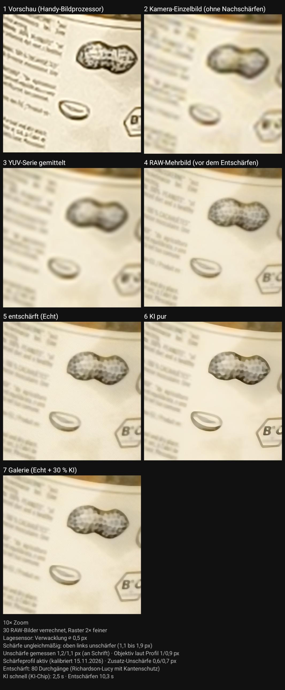

| Schritt | Befund |
|---|---|
| 1 Vorschau | klar am schärfsten: Kleinschrift fast lesbar, Erdnuss-Struktur sichtbar |
| 2 Kamera-Einzelbild | **viel weicher als die Vorschau** – hier geht der Großteil verloren |
| 3 YUV gemittelt | kaum besser als 2 |
| 4 RAW-Mehrbild | deutlich besser als 2/3 (echter Gewinn der Mehrbild-Technik) |
| 5 entschärft | etwas klarer, erste Säume |
| 6 KI | Plastik-Look, glatte Flächen |

**Schluss:** Unsere Rechenkette arbeitet richtig, aber sie startet mit schlechterem
Rohmaterial als die Vorschau. Wir holen das ganze Sensorbild (12 MP, je 4 Pixel
zusammengefasst) und schneiden 10× selbst heraus – nur ≈ 400 × 300 echte Pixel.
Die Vorschau dagegen bekommt vom Bildprozessor vermutlich die Bildmitte in voller
50-MP-Auflösung („In-Sensor-Zoom“). Den offiziellen Weg zur vollen Auflösung
(Ultra-HR) gibt Xiaomi für fremde Apps nicht frei (siehe Kamera-Check).

**Version 1.3 – Hintertür Kamera-Zoom:** Die App lässt den Bildprozessor jetzt selbst bis
2× zoomen (dort schaltet der Sensor vermutlich auf volle Auflösung der Mitte) und rechnet
nur den Rest des Zooms selbst. RAW entfällt in diesem Modus, weil der RAW-Strom den Zoom
nicht mitmacht. Unter *Mehr › Quelle* lässt sich der alte Weg wieder einschalten – so
können beide Diagnosebilder direkt verglichen werden. Ob die Hintertür wirklich mehr
Detail liefert, zeigt erst das nächste Diagnosebild (Kachel 2 gegen Kachel 1).

**Zweites Diagnosebild (Version 1.3, Quelle Kamera-Zoom):** 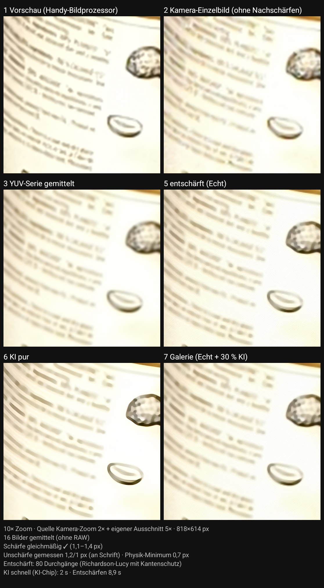

| Schritt | Befund |
|---|---|
| 2 Kamera-Einzelbild | **deutlich näher an der Vorschau** als in 1.2.1 – die Hintertür geht ein Stück auf (818 × 614 statt ≈ 410 × 310 Pixel bei 10×) |
| 3 gemittelt (16 Bilder) | **weicher als das Einzelbild** – das Übereinanderlegen ist nicht genau genug |
| 6 KI | macht aus kleiner Schrift gleichmäßige Striche |

**Ursachen und Version 1.4:**
- Das YUV-Mitteln richtete jedes Bild nur *als Ganzes* aus (eine Verschiebung, gemessen in der
  Bildmitte). Bei 10× dreht schon eine winzige Handdrehung die Ränder um mehrere Pixel weg.
  Neu: **kachelweises Ausrichten in zwei Stufen** (grob auf Viertel-Auflösung bis ±12 px,
  dann fein in voller Auflösung, Ausreißer durch Nachbarn ersetzt).
  Simulation (`tools/sim/AlignTest.kt`, Restfehler der Ausrichtung):

  | Bewegung zwischen zwei Bildern | nur global | kachelweise |
  |---|---|---|
  | nur Verschiebung | 0,11 px | 0,11 px |
  | Drehung 0,4° | 2,24 px | 0,24 px |
  | Drehung 0,8° + Zoom 0,3 % | 4,66 px | 0,49 px |

- Unscharfe Bilder (Verwacklung, Fokusatmen) zogen das Mittel herunter. Neu: nur Bilder mit
  mindestens 80 % der Schärfe des besten zählen, gewichtet mit (Schärfe-Anteil)⁴ und dem Lagesensor.
- **KI bei erkannter Schrift aus**: Die Galerie bekommt dann das reine physikalische Ergebnis;
  der KI-Regler im Viewer bleibt zum Ausprobieren.

**Drittes Diagnosebild (Version 1.4):** 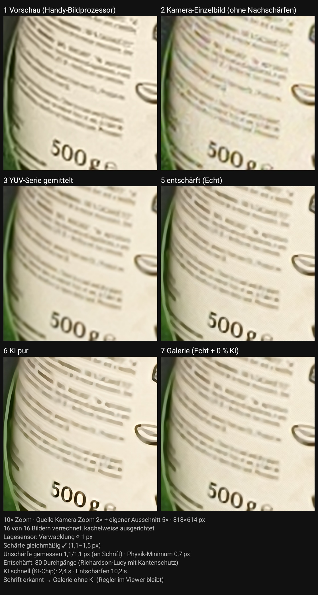

- Das Mitteln macht das Bild **nicht mehr weicher**: Kachel 3 ist mindestens so scharf wie das
  Einzelbild und ruhiger, die bunten Farbsäume sind weg – das kachelweise Ausrichten wirkt.
- Kachel 5 (entschärft) kommt nah an die Vorschau, aber **„500 g“ sticht heraus** (Johns Blick):
  kräftige Kanten wirken hart und „aufgeklebt“ neben der blassen Kleinschrift.
- Die Vorschau bleibt knapp vorn.

**Johns Ziel:** die volle Sensorauflösung (50 MP). Weil Xiaomi sie fremden Apps sperrt,
gehen wir zwei Wege gleichzeitig (Version 1.5):

1. **Umweg über die Xiaomi-Kamera** (Johns Entscheidung): Knopf „50 MP“ öffnet die
   Kamera-App, John macht dort 1–8 Fotos im 50-MP-Modus, beim Zurückkommen holt die App die
   neuen Fotos automatisch. Ausschnitt und Zoom werden gewählt, mehrere Fotos kachelweise
   übereinandergelegt, gebremst entschärft – und wieder ein **Diagnosebild**, diesmal mit
   der Kachel „wie 12 MP“ zum direkten Vergleich, was die 50 MP wirklich bringen.
   Geht auch über *Teilen* aus der Galerie oder *Mehr › Fotos importieren*.
2. **50-MP-Test** im Kamera-Check: probiert alle bekannten Wege (getrennt gelistete
   „High-Resolution“-Größen, offizieller Ultra-HR-Modus, einzelne physische Kameras,
   versteckte Kamera-Nummern), nimmt jeweils wirklich ein Bild auf und speichert es.
   Erst das gespeicherte Bild zeigt, ob echte Details drin sind oder nur hochgerechnet wurde.

**Entschärfen gebremst** (gegen das „aufgeklebte 500 g“): Änderung je Pixel weich gedeckelt,
helle Säume über dem hellsten Nachbarn begrenzt. Simulation (`tools/sim/TameTest.kt`,
Unschärfe σ = 1,2 px, Anteil des zurückgeholten Kontrasts):

| | blasse Striche | kräftige Striche | heller Saum |
|---|---|---|---|
| Richardson-Lucy | 82 % | 86 % | +5,2 % |
| gebremst | 76 % | 76 % | +2,2 % |

Beide Strich-Arten werden jetzt gleich stark zurückgeholt, der Saum ist halbiert.

**Erster 50-MP-Import (15.11.2026, nachts, Raumlicht):** 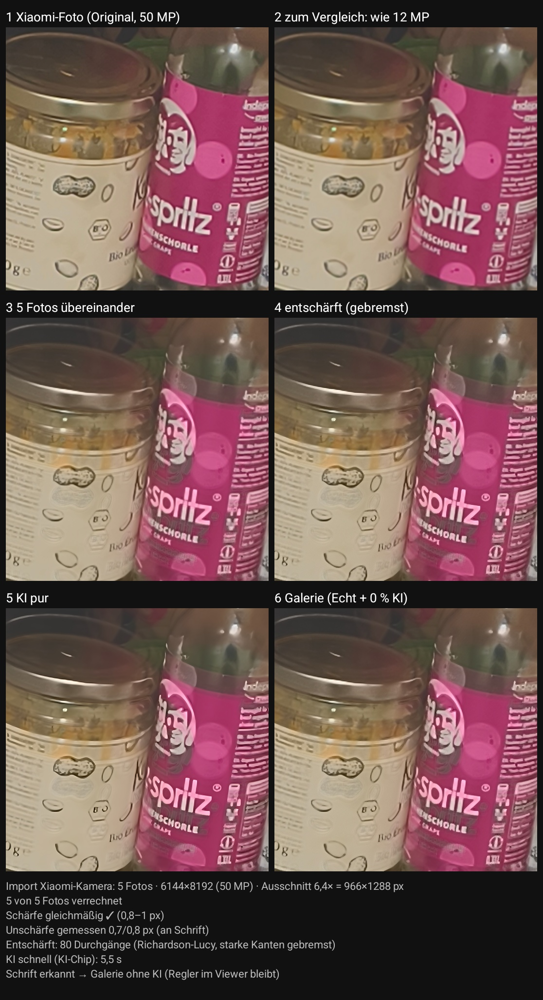

- Der 50-MP-Modus der Xiaomi-Kamera speichert **nur im Format 3:4** wirklich 50 MP
  (6144 × 8192). Im langen Vollbildformat kamen nur 7 MP (1836 × 4080) – trotz „50M“.
- **Ernüchternd:** Kachel 1 (50 MP) und Kachel 2 (auf 12 MP verkleinert) sehen fast gleich
  aus. Bei diesem Licht bringt Xiaomis 50-MP-Modus kaum echte Zusatzdetails – vermutlich
  rechnet die Kamera die Pixel bei wenig Licht stark glatt. Muss bei Tageslicht wiederholt werden.
- **Doppelbilder** beim Übereinanderlegen der 5 Fotos: Zwischen Fotos aus der Hand liegen
  bei 50 MP Hunderte Pixel; die Suche reichte nur ±40 px.

**Version 1.6:** Suche bis ±400 px (erst auf 1/16 Auflösung, dann fein), kachelweise Suche
±20 px und einseitige Ränder (bei großer Verschiebung bleibt die andere Bildseite nutzbar),
und eine **Passprobe**: Nach dem Ausrichten wird der Restfehler jedes Fotos gemessen; Fotos,
die nicht deckungsgleich sind, fliegen raus, statt Doppelbilder zu erzeugen.
Simulation (`tools/sim/AlignTest.kt`, Fotos aus der Hand):

| Bewegung | Ausrichtfehler | Restfehler (passt bis 6) |
|---|---|---|
| 230/−170 px + 0,5° Drehung | 0,21 px | 4,6 |
| −380/290 px + 0,9° Drehung | 0,31 px | 5,7 |
| Kontrolle: 8 px daneben | – | 36,5 → wird aussortiert |

Außerdem: Ausschnitt-Rahmen wird relativ gezogen (Finger verdeckt nichts, Johns Hinweis),
Diagnose-Kacheln beim Import zeigen 300 Pixel vergrößert, damit Unterschiede sichtbar sind.

**Zweiter 50-MP-Import (Version 1.6):** 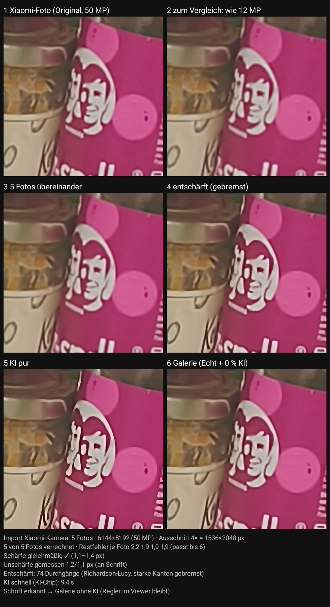

Ausrichten gelöst: alle 5 Fotos passen (Restfehler 1,9–2,2, Grenze 6), keine Doppelbilder.
Aber: 50 MP ≈ 12 MP, und gegenüber dem, was das Handy selbst liefert, keine sichtbare
Verbesserung. Johns Fazit: Die Bildverbesserung selbst muss besser werden.

**Version 1.7 – KI mit bekannter Unschärfe (DPIR):** Die bisherige KI (Real-ESRGAN) schaut
auf ein Bild und rät – daher Plastikflächen und Striche statt Buchstaben. Neu ist ein
Verfahren, das **Physik und KI abwechselt** (Zhang et al. 2021, „Plug-and-Play Image
Restoration with Deep Denoiser Prior“):

1. *Physik-Schritt*: Welches scharfe Bild ergibt – mit **unserer gemessenen Unschärfe**
   (Messung an Schrift, Kalibrierprofil) verwischt – genau das Foto? Exakt lösbar im Frequenzraum.
2. *KI-Schritt*: ein Entrausch-Netz (DRUNet) entfernt die Störungen, die dabei entstehen.
   Es weiß, wie saubere Bilder aussehen, erfindet aber keine Formen.

So werden Kalibrierung und Messung zum ersten Mal direkt Teil der KI.
Simulation am PC (`tools/sim/dpir_sim.py`, Kleinschrift + „500 g“, Unschärfe σ = 1,2 px):

| Verfahren | Rauschen 1/255 | Rauschen 3/255 |
|---|---|---|
| unscharf | 19,4 dB | 19,3 dB |
| Richardson-Lucy (bisher) | 21,4 dB | 20,9 dB |
| RL gebremst (1.5) | 21,1 dB | 20,8 dB |
| **DPIR, 8 Durchgänge** | **24,1 dB** | **22,3 dB** |
| DPIR, 4 Durchgänge | 23,8 dB | 22,3 dB |

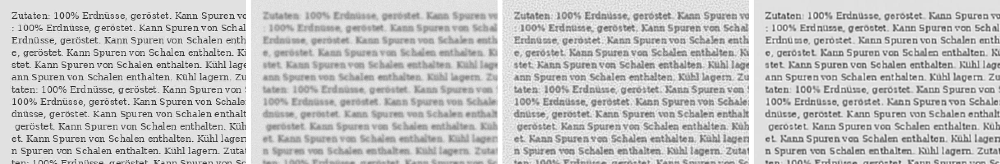

*Von links: Vorlage · unscharf + Rauschen · bisher (RL gebremst) · DPIR.* Die Kleinschrift
wird lesbar statt körnig. Auf dem Handy: 3 Durchgänge (kaum schlechter: 22,65 vs. 22,79 dB),
Kacheln 256 × 256 mit 24 px Umfeld (Kacheln kosten nichts: 22,71 dB), Mitte zuerst, Zeitbudget
2 Minuten (stark: 5); die Kotlin-Umsetzung stimmt mit der PC-Referenz auf 0,000002 überein.
Ersetzt die Allzweck-KI; diese bleibt als Rückfall, falls das Modell nicht lädt.

**Erster DPIR-Import (15.11.2026, ca. 4 Uhr, Raumlicht):** 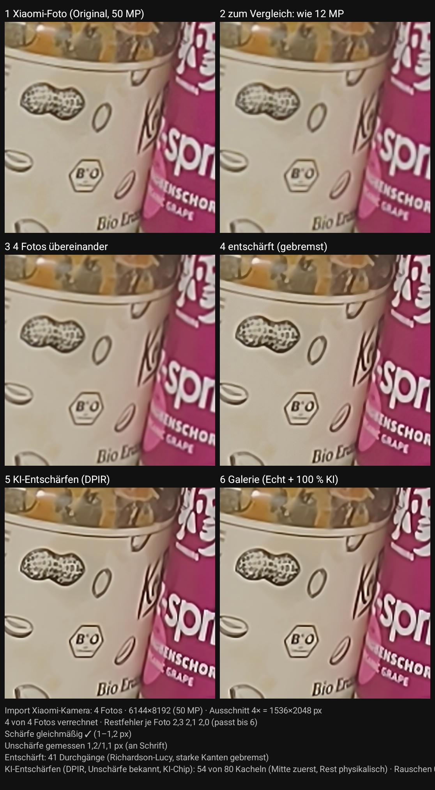

Johns Urteil im Viewer (Linie zwischen Xiaomi-Foto und Ergebnis): **„deutlich besser“** –
erstmals schlägt die App sichtbar, was das Handy selbst liefert. Kachel 5 (DPIR): klare Kanten,
keine Säume, kein Plastik-Look, keine erfundenen Striche. Einschränkungen: nur 54 von 80
Kacheln in 2 Minuten (Rest physikalisch), und offen ist, ob es **echtes Detail** ist oder nur
kräftigere Schärfe (Johns Frage).

**Version 1.8:**
- **Gegenprobe** im Diagnosebild: das Xiaomi-Foto *nur klassisch nachgeschärft*
  (Unscharf-Maskieren), automatisch so stark eingestellt, dass die Kanten genauso kräftig
  sind wie bei DPIR. Sieht DPIR daneben immer noch besser aus, holt es echte Details.
- **Vollständiger:** flache Kacheln (Wand, Himmel) werden übersprungen, Zeitbudget 5 Minuten
  (stark: 10) – Johns Vorgabe „Zeit spielt keine Rolle“.
- **Farben getrennt, wenn nötig:** Die Unschärfe von Rot, Grün, Blau wird am Bild selbst
  gemessen; weichen sie mehr als 15 % voneinander ab, rechnet DPIR jede Farbe mit ihrer
  eigenen Unschärfe zurück (dreifache Zeit), sonst gemeinsam.

**Gegenprobe (Version 1.8, 15.11.2026 vormittags):** 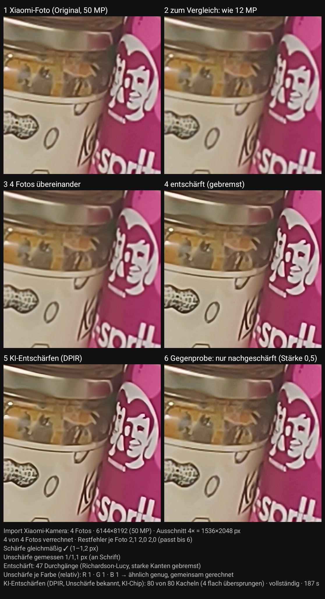

Erstmals alle 80 Kacheln mit DPIR (187 s, 4 flache übersprungen); R, G, B gleich unscharf
(gemeinsam gerechnet). Kachel 5 (DPIR) gegen Kachel 6 (nur nachgeschärft, gleich kräftige
Kanten): sehr ähnlich; DPIR ruhiger und sauberer, die Gegenprobe zeigt an der Erdnuss etwas
mehr Struktur. Johns Urteil: Unterschied erkennbar, DPIR besser. Gemessene Unschärfe nur
≈ 1 px – das Xiaomi-JPEG ist schon nahe an dem, was Objektiv und Bildverarbeitung hergeben.

**50 MP als RAW?** Der 50-MP-Test (alle Kameras, auch versteckte) fand **keine einzige
Größe über 14 MP** – die Sperre sitzt schon in der Liste. Open Camera (Camera2, RAW/DNG)
bietet ebenfalls höchstens 4096 × 3072. Die Xiaomi-Kamera speichert beim Poco X7 Pro kein RAW.

**Version 1.8.1 – Namens-Test:** Xiaomi gibt manche Kamera-Funktionen nur bestimmten
App-Namen frei (so kommen GCam-Varianten an versteckte Objektive). Zwei Testversionen mit
den Paketnamen `com.google.android.GoogleCamera` (Test G) und `org.codeaurora.snapcam`
(Test S) laufen neben der normalen App; in beiden wird der 50-MP-Test wiederholt.
Rooten wurde verworfen (Banking-Apps, Garantie).

**Ergebnis Namens-Test:** Auch als `GoogleCamera` und `snapcam` keine Größe über 12,6 MP.
Aber der Bericht zeigt die **Hersteller-Schalter** des Sensors (MediaTek/Xiaomi), u. a.
`com.mediatek.control.capture.remosaicenable`, `xiaomi.remosaic.enabled`,
`com.xiaomi.control.qcfa.isSuperRemosaic`, `com.xiaomi.sensor.info.binningFactor`,
`com.xiaomi.scaler.availableSuperResolutionStreamConfigurations`, `xiaomi.superResolution.yuvsize`.
„Remosaic“ ist genau der Vorgang, der aus dem Vierer-Pixel-Sensor (Quad-Bayer) die vollen
50 MP macht. **Version 1.8.2** liest die Werte dieser Schlüssel aus und nimmt wirklich damit auf:
12 MP normal (Vergleich), 12 MP mit Remosaic (YUV und RAW), alle angebotenen
Super-Resolution-Größen und die größte Größe in acht Hersteller-Sitzungsarten.

**Erster Lauf (Test S):** Vergleichsbild 12,6 MP gelang; beim ersten Versuch *mit* allen
Remosaic-Schaltern gleichzeitig **stürzte die App ab** – der Schalter wird also nicht einfach
ignoriert. Die Eigenschafts-Werte wurden nicht angezeigt (Hersteller-Eigenschaften sind nicht
aufgelistet). **Version 1.8.3:** jeder Schalter einzeln (nur Anfrage / auch Sitzung),
Eigenschaften über ihren Namen mit geratenem Datentyp gelesen, Protokoll Zeile für Zeile in
eine Datei, Absturzursache wird mitgeschrieben, und der Versuch, bei dem es abstürzte, wird
beim nächsten Start übersprungen – so kommt der Test Schritt für Schritt durch.

**Ergebnis 1.8.3 (15.11.2026, mittags):** Nach einigen automatisch übersprungenen Abstürzen lief
der Test durch. Die versteckte Liste `com.xiaomi.scaler.availableSuperResolutionStreamConfigurations`
enthält **8192 × 6144** in den Formaten YUV (35), JPEG (33), privat (34) und RAW (32);
`binningFactor` = 4, `qcfa.supported` = 1. Ergebnis der Aufnahmen:

| Versuch (Kamera 0) | Ergebnis |
|---|---|
| Remosaic-Schalter einzeln, 12 MP | angenommen (int[] bzw. byte[]), Bild 12,6 MP |
| **JPEG 8192 × 6144 + alle Remosaic-Schalter** | **✓ 50,3 MP – erstes 50-MP-Bild aus der eigenen App** |
| YUV 8192 × 6144 | nur 1920 × 1440 (Ersatzbild) |
| RAW 8192 × 6144 | Sitzung abgelehnt |
| Hersteller-Sitzungsarten 0x8001–0x9001 | nur 1920 × 1440 |

Damit kommt die App ohne Umweg über die Xiaomi-Kamera an 50 MP – allerdings als JPEG,
also vom Bildprozessor bearbeitet. Johns Einwand: Ein „50-MP-RAW“ gibt es bei diesem Sensor
im eigentlichen Sinn gar nicht (die Vierergruppen müssen erst umgerechnet werden). Ob das
50-MP-JPEG echtes Mehr-Detail enthält, misst Version 1.9 („Foto prüfen“): Feinstruktur-Energie
jenseits des 12-MP-Rasters, getrennt nach Kanten und glatten Flächen, im Vergleich zu einem
wirklich hochgerechneten Bild (Simulation: hochgerechnet ≈ 1,7, echte 50 MP ≈ 5,5,
unscharfe 50 MP ≈ 2,2), plus Vergleichsbild der drei strukturreichsten Stellen.
Über den Chat verschickte Bilder werden verkleinert – deshalb läuft die Prüfung in der App.

**Korrektur (15.11.2026, 12:30):** Das vermeintliche 50-MP-Bild war ein **Fehlalarm**. Die Prüfung
der Datei ergab 1920 × 1440: Der Treiber hatte einen Puffer in 8192 × 6144 angenommen, aber nur
das kleine Ersatzbild hineingeschrieben; der Test hatte die gemeldete Größe nicht am Bildinhalt
überprüft. Lehre: **jedes Ergebnis an der gespeicherten Datei nachmessen.**

**Recherche (Community, XDA, Hersteller):** Kein bekannter Weg zu 50-MP-RAW am Poco X7 Pro ohne
Root. Xiaomi steuert, welche fremden Apps mehr dürfen, über eine Freigabeliste in den
Systemeigenschaften (`vendor.camera.aux.packagelist`, meist höchstens 4 App-Namen);
ändern lässt sie sich nur mit Root. GCam-Ports brauchen ebenfalls Eingriffe in Systemdateien.
Version 1.9.3 liest die lesbaren Kamera-Eigenschaften aus.

**Ergebnis:** `vendor.camera.aux.packagelist` ist lesbar und enthält nur Xiaomis eigene Test- und
Werksprogramme. Entscheidender ist aber: Über die Kamera-Schnittstelle meldet der Hauptsensor
(Sony IMX882 laut `persist.vendor.camera.mi.module.info`) bei *jeder* Kamera-ID höchstens
4096 × 3072, auch für RAW, und „Ultra-HR: nein“. Die 50 MP entstehen in Xiaomis eigener Bildkette
(`persist.sys.miui.camera.version = mtk`, MiVi Version 2), nicht in der Schnittstelle, die Apps
nutzen. **Schluss: Auf diesem Handy sind 50 MP für eigene Apps ohne Root nicht erreichbar.**
Der Weg über App-Namen wurde nicht weiter verfolgt – er hätte allenfalls weitere Linsen
freigeschaltet, nicht die Auflösung. Der funktionierende Weg bleibt: 50-MP-JPEG aus der
Xiaomi-Kamera (Pro-Modus, Format 3:4) + Import + Schärfe zurückholen (DPIR).

**Erster Tagestest (15.11.2026, nachmittags):** 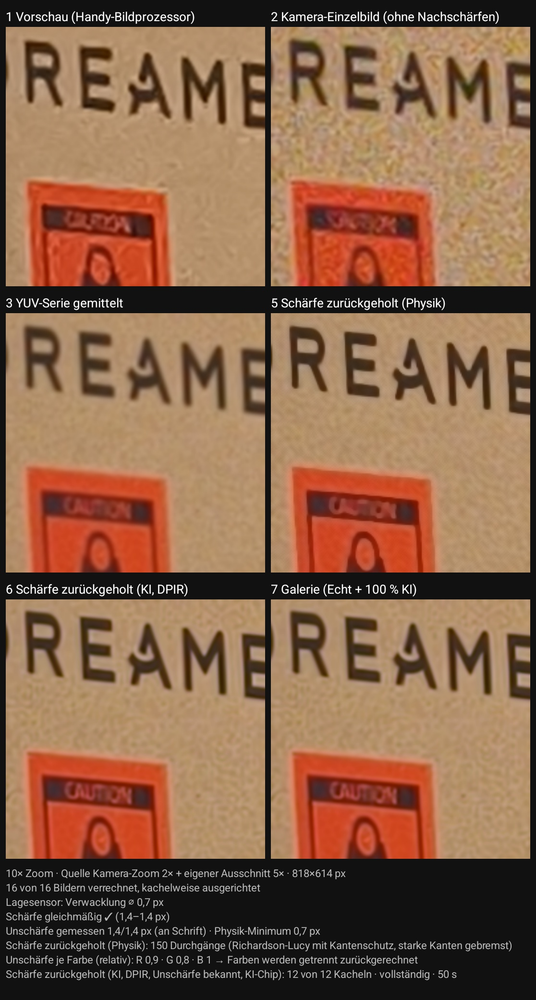

Johns Urteil: Kleinschrift „von unlesbar zu lesbar – erstaunlich gut“. Drei Beobachtungen:
1. Bei Spiegelungen (Auto) **verschob sich die Farbe** – die App hatte die Farben getrennt
   zurückgerechnet, weil die Messung R 0,9 · G 0,8 · B 1,0 ergab. An fertig bearbeiteten
   Kamerabildern ist so eine Messung zu unsicher.
2. **Große, kräftige Schrift** wirkt mit der Physik-Rechnung randschärfer, **feine, helle Schrift**
   auf dunklem Grund mit DPIR (vgl. Kachel 5 und 6: „CAUTION“).
3. Die Schärfe passt manchmal nicht zur Entfernung (Fernes zu knackig) – offen.

**Version 1.11:** nur noch die Helligkeit wird geschärft, Farben bleiben vom Original; an
kräftigen Kanten (Kontrast im 7 × 7-Umfeld) wird bis zu 70 % Physik-Schärfe eingemischt, sonst
DPIR, weich überblendet; Knopf „Echt ⇄ KI umschalten“ im Viewer für den direkten Vergleich an
derselben Stelle; **Kalibrieren für 50 MP**: fünf Xiaomi-Fotos des iPad-Musters (Mitte, Ecken),
die App findet das Muster selbst und misst die Unschärfe in Pixeln des 50-MP-Fotos – genutzt
beim Import je Bildstelle (Profil² + Zusatz² dieses Fotos), wie beim RAW-Weg.

**Erste 50-MP-Kalibrierung:** Mitte 4,19 px, Ecken 3,59–4,48 px, Farben bis 43 % abweichend – Ecken
teils schärfer als die Mitte. Beim Import mit 10× ergab das **massive Überschärfung** mit hellen
Rändern und Mustern („ganz katastrophal“), denn am selben Foto maß die Schrift nur ≈ 1 px.
Ursache vermutlich: Verwacklung bei 1,5 m Abstand aus der Hand und Xiaomis Bildbearbeitung
(Tonkurve, Schärfung), die die Kantenmessung am Muster anders beeinflusst als an Schrift.
**Version 1.11.1:** Das Profil liefert nur noch den *Verlauf* über das Bild (Faktor 0,75–1,35
gegenüber der Ausschnittsmitte); die *Stärke* misst die App in jedem Foto selbst. Profil löschbar.
Lehre: **absolute Kalibrierwerte nie ungeprüft übernehmen – gegen die Messung im Bild absichern.**

**Befund 15.11.2026, nachmittags:** Mit dem 50-MP-Profil nur als Verlauf sind die Ränder weg. Und:
**Der eigene Weg (12-MP-Serie aus der App, Kamera-Zoom 2×, 16 Bilder gemittelt, DPIR) schlägt das
50-MP-Foto der Xiaomi-Kamera deutlich** – im 50-MP-Foto war die Schrift unlesbar, im eigenen
Ergebnis lesbar (Johns Vergleich). Erklärung: Bei 50 MP bekommt jedes Pixel nur ein Viertel Licht,
die Kamera bügelt das Rauschen weg und mit ihm die Feinheiten. Viele ehrliche Bilder schlagen ein
geschöntes Riesenbild.

**Nächster Hebel – RAW-Super-Resolution (Version 1.12):** Das Handzittern verschiebt jedes Bild
um Bruchteile eines Pixels; die Rohpixel (je eine Farbe) werden an ihrer exakten Position in ein
doppelt so feines Raster eingetragen, ohne Farben zu erraten (Prinzip wie Googles „Handheld
Super-Resolution“). Die App kann das seit Version 0.5, hatte es aber zugunsten des Kamera-Zooms
abgeschaltet. Jetzt läuft es als **Vergleich A/B in einer Aufnahme**: Ein Druck auf den Auslöser
nimmt erst Serie A (bisheriger Weg) und direkt danach Serie B (RAW, 8–30 Bilder) auf. Beide bekommen
„Schärfe zurückholen“ (Physik + DPIR; B mit dem RAW-Kalibrierprofil). Der Viewer zeigt links A,
rechts per Regler bzw. „Echt ⇄ KI“ A oder B; ein gemeinsames Diagnosebild „vergleich_…“ zeigt die
entscheidenden Kacheln. Johns Vorgabe: Jede Neuerung muss sich gegen den guten Weg beweisen.

**Erster A/B-Vergleich (15.11.2026, 10×, Johns Bild „vergleich_…_10x“):** A (Kamera-Zoom, 16 von 16
Bildern) vor B (30 RAW-Bilder, Raster 2× feiner). Befund in zwei Teilen:
1. **Schon die Grundlage von B ist weicher als A**, mit orangem Farbsaum. Bei 10× nutzt B nur
   410 × 306 Rohpixel (zusammengefasste 12-MP-Pixel), A dagegen den hochauflösenden Mittelteil über
   den Kamera-Zoom (818 × 614). Doppelt so feines Raster kann halb so viele echte Pixel nicht
   ausgleichen. Die weichen Farben kommen daher, dass jede Farbe im Rohbild nur jedes zweite Pixel hat.
2. **B mit KI: Gittermuster („verpixelt“) und helle Säume.** Kleine Schrift erstaunlich lesbar,
   aber alles kariert. Ursache: Die KI-Rechnung bekommt eine Rauschstufe mitgeteilt, die aus
   Nachbarpixel-Unterschieden geschätzt wird. Auf dem verfeinerten Raster sind Nachbarpixel eng
   verwandt, die Schätzung fällt viel zu klein aus; damit vertraut der Physik-Schritt den Daten
   fast blind (ρ winzig) und verstärkt das 2-Pixel-Muster des Eintragens, das der Entrauscher
   bei so kleiner Stufe stehen lässt.

**Version 1.12.1:** Rausch-Untergrenze 2/255 für die KI-Rechnung; auf verfeinertem Raster
(Faktor u) wird Schätzung und Untergrenze mit u vervielfacht. Die Diagnose nennt jetzt „Rauschen
gemessen … · für die KI angesetzt …“. Dazu der Knopf **„Diagnose teilen“** im Viewer: das zuletzt
gespeicherte Diagnose- oder Vergleichsbild geht ohne Umweg über die Galerie direkt ins Teilen-Menü.
Erwartung: B verliert das Gitter, bleibt aber bei 10× wohl hinter A – RAW-SR lohnt sich vermutlich
erst dort, wo A keinen Vorteil vom Kamera-Zoom mehr hat. Das muss der nächste Vergleich zeigen.

**Zweiter A/B-Vergleich mit 1.12.1 (15.11.2026, 16 Uhr):** 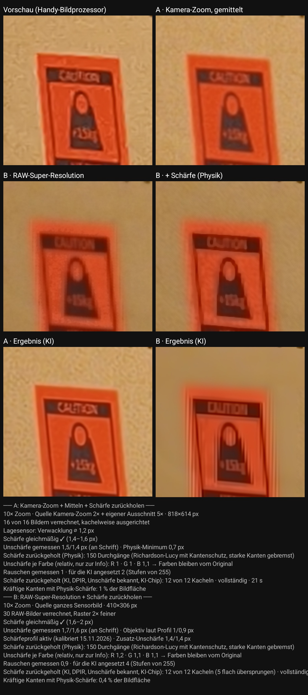
Das Karomuster ist weg (Rauschen gemessen 0,9, angesetzt 4 von 255) – die Ursache war also richtig
erkannt. Übrig bleiben in B **Echo-Streifen parallel zu senkrechten Kanten** (Rand des Schildes,
Gewicht-Symbol): typisches Nachschwingen einer zu kräftigen Entfaltung. Vermutete Ursache: Die
Unschärfe nach dem Eintragen der Rohpixel ist keine Gauß-Glocke (jede Farbe nur jedes zweite Pixel,
dazu leichte Restverschiebung der Bilder aus der Hand); die Rechnung nimmt aber eine Gauß-Glocke
gleicher Kantenbreite an und hebt dadurch mittlere Feinheiten zu stark an. Und schon *vor* jeder
Schärfung ist B weicher als A, mit Farbsaum.

**Urteil nach Johns Regel:** Bei 10× gewinnt A (Kamera-Zoom) deutlich. B kann aus den
zusammengefassten 12-MP-Rohpixeln (410 × 306 im Ausschnitt) nicht aufholen, was A über den
hochauflösenden Mittelteil des Sensors schon hat (818 × 614). RAW-Super-Resolution lohnt sich nur
auf vollen 50-MP-Rohdaten – die gibt das Handy ohne Root nicht her. Lehre: **Mehr Bilder auf
gröberem Raster schlagen nicht weniger Bilder auf feinerem Raster.**

**Nächster Versuch – feines Raster für A (Version 1.13):** Johns Frage „Wie verbessern wir die
Qualität?“ Der Trick von B (Handzittern füllt ein feineres Raster) wird jetzt auf die *guten* Pixel
angewendet: die 16 Bilder aus dem Kamera-Zoom. Bisher werden sie ausgerichtet und auf dem eigenen
Raster gemittelt; neu trägt die App jedes Bild zusätzlich an seiner genauen (Bruchteil-)Position in
ein doppelt so feines Raster ein – in einem Durchgang, Ausrichten und Aussortieren sind gemeinsam.
Der Vergleich ist damit fairer als zuvor: **eine Serie, zweimal gerechnet** (A gemittelt, B fein),
gleiche Bilder, gleiche Verwacklung. Danach beide mit „Schärfe zurückholen“ (Physik + DPIR); B mit
Rausch-Korrektur für das feine Raster und entsprechend mehr Rechenzeit fürs Entfalten.
Ehrliche Erwartung: Die Kamera hat diese Bilder schon entmosaikt (Farben ergänzt) und dabei leicht
geglättet; ob das Handzittern darunter noch echte Feinheit liefert, muss der Test zeigen.

**Ergebnis feines Raster (15.11.2026, 17 Uhr, Version 1.13.1):** 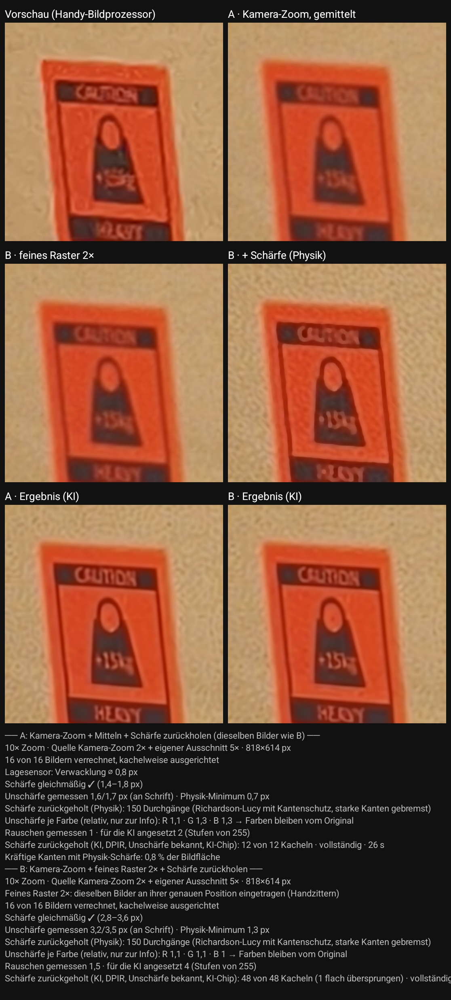
Johns Urteil: A wirkt schärfer und kontrastreicher. Die Zahlen bestätigen das eindeutig: B misst
3,2/3,5 px Unschärfe auf dem doppelt so feinen Raster – umgerechnet **1,6/1,75 px, genau so viel wie A
(1,6/1,7 px)**. Das feine Raster hat also keinen Hauch echter Auflösung gewonnen, nur mehr Pixel für
dieselbe Information (und viermal so viel Rechenzeit: 48 statt 12 KI-Kacheln).

**Was daraus folgt – die wichtigste Erkenntnis des Tages:** Die Grenze ist nicht das Pixelraster,
sondern die **Unschärfe von rund 1,6 px**, die schon im Bild steckt (Objektiv, Entmosaiken und Glätten
der Kamera). Super-Resolution hilft nur, wenn das Raster der Engpass ist. Hier ist es die Unschärfe –
und gegen die hilft nur Entfalten, und wie weit man entfalten kann, bestimmt das **Rauschen**.
Nächste Hebel deshalb: mehr Licht pro Bild bzw. mehr Bilder (weniger Rauschen → kräftiger
entfalten), und eine KI, die genau diese Kamera kennt.

**Test „mehr Bilder“ (Version 1.14):** Wenn Rauschen begrenzt, wie kräftig entfaltet werden darf,
müssen mehr Bilder schärfere Ergebnisse geben. Fairer Test: Die Serie nimmt jetzt 32 Bilder auf.
A rechnet mit dem Referenzbild und den ersten 15 passenden Bildern (16, wie bisher), B mit allen –
gleiche Ausrichtung, gleiches Referenzbild, gleiche Rechenkette. Erwartung bei reinem Rauschen:
Rauschen sinkt um den Faktor √2 ≈ 1,4. Das Diagnosebild nennt „Rauschen gemessen“ für A und B.

**Ergebnis 16 gegen 32 Bilder (15.11.2026, 17:30, Version 1.14):** 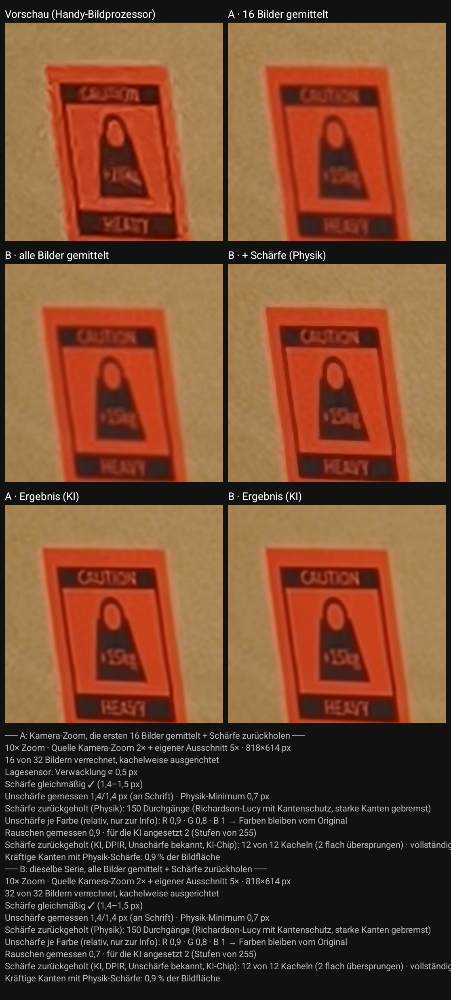
Johns Eindruck: B ruhiger, Kleinschrift minimal besser lesbar, aber etwas weicher. Die Messung:
Rauschen 0,9 → 0,7 (Erwartung ÷ 1,4 ≈ 0,64 – passt), Unschärfe bei beiden 1,4 px. **Aber:** Die KI
rechnete bei *beiden* mit Rauschen 2 – die Untergrenze aus 1.12.1 (gedacht fürs feine RAW-Raster)
galt auch auf dem normalen Raster. Das geringere Rauschen von B wurde also nicht zum kräftigeren
Schärfen genutzt, nur zum Glätten. Wahrscheinlich hat die Untergrenze auch A seit 1.12.1 etwas
weicher gemacht (Johns Bemerkung beim 1.13-Test: „das normale Bild ist jetzt ein bisschen schlechter“).
**Version 1.14.1:** Untergrenze nur noch auf feinerem Raster; auf dem normalen Raster rechnet die
KI wieder mit dem gemessenen Rauschen. Gleicher Test noch einmal.

**Ergebnis 16 gegen 32 Bilder, richtig gerechnet (15.11.2026, 17:43, Version 1.14.1):** 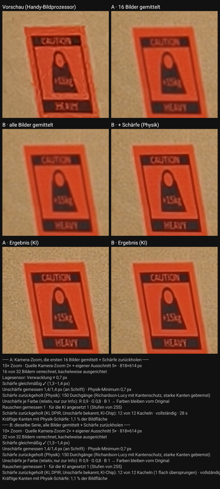
Jetzt rechnet die KI mit dem gemessenen Rauschen (A und B: 1 von 255) – und beide messen *gleich*
viel. Johns Urteil: B ruhiger, aber Karton und Schrift weicher. Deutung: Was die Messung als
„Rauschen“ sieht, ist bei dieser Helligkeit überwiegend echte Kartonstruktur, nicht Zufallsrauschen –
das Rauschen ist schon mit 16 Bildern so klein, dass es nicht mehr bremst. Die Bilder 17–32 sind
später aufgenommen, das Handy ist weiter gewandert; ihre winzigen Restfehler beim Ausrichten
glätten Struktur weg. **Mehr Bilder bringen hier keine Schärfe – 16 bleibt richtig.**

**Bilanz der drei Versuche vom 15.11.:** RAW-Super-Resolution, feines Raster, mehr Bilder – keiner
schlägt den bisherigen Weg. Zusammen zeigen sie, wo die Grenze liegt: **eine Unschärfe von rund
1,4–1,6 px, die schon im Bild der Kamera steckt** (Objektiv, Sensor, Entmosaiken), bei sehr wenig
Rauschen. Weder mehr Raster noch mehr Bilder holen da etwas heraus; nur ein besseres Wissen über
genau diese Unschärfe – also eine KI, die mit Bildpaaren *dieser* Kamera nachtrainiert wird.
Johns Auge war bei jedem Versuch das zuverlässigste Messgerät: Glatt wirkt auf den ersten Blick
hochwertiger, aber er erkennt verlorene Struktur sofort.

**Version 1.15:** Aufnahme-Fortschritt („12/16“ und Balken) direkt unter dem Fokusrahmen am Motiv,
nicht nur am Auslöser (Johns Wunsch – man schaut beim Fotografieren aufs Motiv). Vergleich A/B
standardmäßig aus (bleibt im Menü „Mehr“ als 16 gegen 32 Bilder), Aufnahme wieder mit 16 Bildern.

**Klarheit (Version 1.16):** John hat das fertige Foto in der Galerie mit dem Regler „Klarheit“
bearbeitet – es wirkte sichtbar besser. Deutung: Unser Ergebnis ist bei mittelgroßen Strukturen
(Kartonfaser, Buchstabenflächen) noch etwas zurückhaltend – „Schärfe zurückholen“ arbeitet bewusst
nur im Bereich der gemessenen Unschärfe (1–2 px), Klarheit dagegen großflächig (Radius ≈ 1/60 der
Bildseite). Nachgebaut: Grundbild per **Guided Filter** (He et al. 2010) auf Viertel-Auflösung –
kantenschonend, folgt kräftigen Kanten (dort keine Säume) und glättet nur mittelstarke Struktur.
Detail = Bild − Grundbild, verstärkt bis 1,5×, am stärksten in den Mitteltönen, nur Helligkeit.
Im Viewer als eigener Regler „Klarheit“ (Start 30 %, merkt sich Johns Einstellung), wirkt auf die
rechte Seite; links bleibt das Normalbild als Maßstab. „Mischung speichern“ speichert mit Klarheit.
Hinweis zur Ehrlichkeit: Klarheit erzeugt keine neuen Details, sie macht vorhandene sichtbarer.

**Klarheit verbessert (Version 1.16.1):** Johns Test: 30 % zu kräftig, 18 % gut; an Kanten (Schriftzug
„DREAME“, Rand des Aufklebers) ein schmaler, glatter, etwas hellerer Streifen ohne Kartonstruktur.
Ursache: Der Guided Filter erkennt in einem ganzen Umkreis (≈ 40 px) um jede kräftige Kante „Kante“
und schaltet dort die Verstärkung ab – daneben wird die Struktur betont, der Streifen fällt auf.
Neu: Grundbild einfach großflächig weichgezeichnet; die Abweichung davon wird **weich gedeckelt**
(tanh): feine Struktur voll verstärkt, gleichmäßig bis an die Kante; große Abweichungen (Kanten)
zählen kaum, und aufhellen ist enger gedeckelt (≈ 6 Stufen) als abdunkeln (≈ 13) – keine hellen Säume.
Am Screenshot nachgerechnet: Struktur reicht jetzt bis an die Buchstaben, kein heller Rand.
Startwert 20 % (Johns Wert bleibt gespeichert).

**Guter Stand gesichert (15.11.2026, abends):** Johns Urteil nach weiteren Fotos: „Die Qualität ist
wirklich beachtlich … ein Unterschied wie Tag und Nacht zur normalen Handykamera, die künstlich wirkt.“
Version 1.16.1 ist als Zweig `guter-stand-2026-11-15` gesichert; ihre APK bleibt dauerhaft unter
Release v51 abrufbar. Alles Neue danach ist abschaltbar und standardmäßig aus – die Bildrechnung
selbst bleibt unverändert.

**Plastizität und 3D (Version 1.17, Johns Idee):** Ein Foto ist flach, unser Auge liest Tiefe aber aus
Hinweisen: Nahes ist kontrastreicher, Fernes weicher und dunstiger (Luftperspektive). Dazu braucht
die App eine **Tiefenkarte** – geschätzt aus dem einen Bild mit **MiDaS v2.1 small** (Ranftl et al.,
MIT-Lizenz; 256 × 256, fp16-Gewichte, 33 MB, auf dem Handy wenige Sekunden). Sie kennt keine Meter,
nur „was liegt vor was“.
- **Regler „Plastizität (Tiefe)“** im Viewer: nah bis zu doppelte Klarheit plus Extra-Mikrokontrast,
  fern Klarheit zurück bis 0 und ein Hauch Dunst (heller, flacher). Standard: aus.
- **„3D ansehen“**: das Ergebnis wird nach Tiefe in 10 weich ausgeblendete, kumulative Schichten zerlegt;
  nahe Schichten wandern bei Bewegung stärker als ferne (wie die Facebook-3D-Fotos ab 2018). Läuft von
  selbst im Kreis, mit dem Finger steuerbar. Kumulative Schichten vermeiden Löcher – an Vordergrundkanten
  dehnt sich das Bild leicht.
- Grenze, ehrlich: Bei starkem Zoom auf Fernes liegt fast alles gleich weit weg – dort bringt Tiefe wenig.
  Gedacht für Szenen mit Vorder- und Hintergrund.
Außerdem: Der runde Griff der Vergleichslinie sitzt jetzt am unteren Rand (Johns Wunsch: die Bildmitte
ist das Motiv).

**Fehlschlag mit Tiefe im Bild (15.11.2026, 20 Uhr, Version 1.17):** 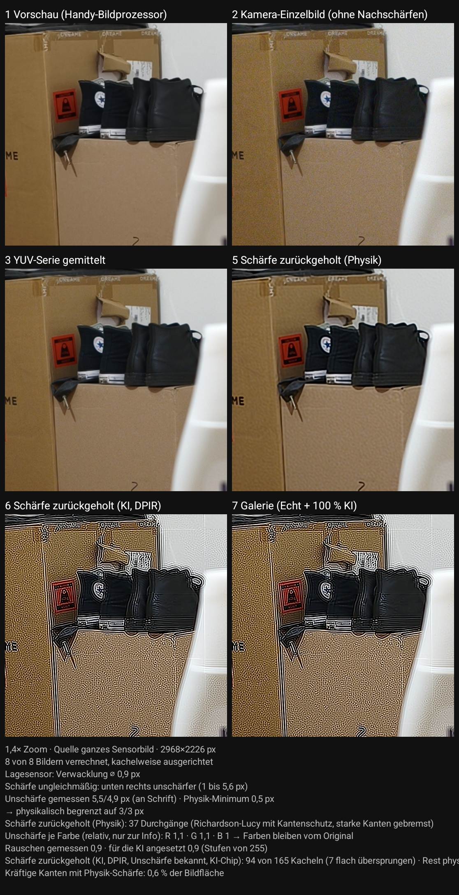
Szene mit Vorder- und Hintergrund (Schuhe auf Karton, weiße Flasche unscharf davor), 1,4× Zoom.
Johns Urteil: „grauenhaft schlecht, extreme weiße Säume“. Das Diagnosebild zeigt: Kacheln 1–3 gut,
5 (Physik) schon mit Säumen, 6 (DPIR) voller Ringe. Ursache – nicht die neuen Regler, sondern die
Unschärfe-Messung: Die Gleichmäßigkeitsprüfung meldete 1 bis 5,6 px (unscharfe Bereiche liegen
außerhalb der Schärfeebene), die Schriftmessung 5,5/4,9 px, begrenzt auf 3/3 px. Mit 3 px auf die
*scharfen* Kanten (≈ 1 px) angewandt, schießt die Entfaltung weit über – und die KI rechnete dazu
mit sehr wenig Rauschen (0,9), also fast ohne Bremse.
**Version 1.17.1:** (1) Ist die Schärfe ungleichmäßig, wird für die **schärfste Stelle** geschärft
(höchstens 1,15 × deren Wert) – Unscharfes außerhalb der Schärfeebene kann man ohnehin nicht
zurückholen. (2) Sicherung in der KI: Rauschen nie unter 0,6/255 je Pixel Unschärfe – bei 1,4 px
(guter Weg) ohne Wirkung, bei 3 px eine kräftige Bremse.
Lehre: **Bei Tiefe im Bild gibt es nicht „die eine“ Unschärfe.** Langfristig: Unschärfe je Bildstelle
aus Messung und Tiefenkarte.

**Johns Test der Plastizität (15.11.2026, abends, Version 1.17.1):** Die weißen Säume in der Schuh-Szene
sind mit 1.17.1 behoben. Aber: Der Dunst ließ den Hintergrund blass und unrealistisch wirken – „Dunst in
der Wohnung bei drei Metern?“ Richtig: Luftperspektive entsteht erst über Kilometer. **Version 1.17.2:**
Dunst entfernt, Plastizität nur noch über die Schärfe (nah knackiger, fern weicher). 3D-Ansicht
bildschirmfüllend mit Zwei-Finger-Zoom, Verschieben, Doppeltippen und Regler „3D-Stärke“. Im Viewer
liegen Klarheit und Tiefe hinter dem Knopf „Klarheit & Tiefe“, damit das Bild groß bleibt.

**Autofokus neu (Version 1.18, Johns Wunsch):** Johns Befund am Abend: Das Scharfstellen ist nicht
zuverlässig – es pumpt nach, und manchmal zeigt es grün, obwohl es nicht scharf ist. Ursache: Der eigene
Kontrast-Durchlauf (seit 0.7, weil Xiaomis Autofokus in 0.6 den Vordergrund bevorzugte) ist bei wenig Licht
oder schwacher Struktur unsicher, meldete aber immer grün; das stille Nachprüfen alle 5 s war als Pumpen
sichtbar. Neu, als Mischung aus beiden Welten:
1. **Phasen-Autofokus** der Kamera mit dem Rahmen als Messfeld (schnell, auch bei wenig Licht).
2. **Bestätigung** mit der eigenen Kontrastmessung in einem engen Bereich um dessen Ergebnis. Liegt das
   Maximum am Rand des Bereichs, lag der Phasen-Autofokus daneben (z. B. Vordergrund) → voller eigener
   Durchlauf wie bisher. Antwortet er nicht binnen 1,5 s → ebenso.
3. **Grün nur bei klarem Schärfe-Maximum**; ist die Kurve flach (< 6 % Unterschied), wird der Rahmen
   als unsicher markiert und die App sagt es.
4. **Kein Pumpen mehr:** Nachgeprüft wird nur, wenn die gemessene Schärfe im Rahmen zweimal hintereinander
   unter 60 % des Werts beim Scharfstellen fällt.
Makro behält den eigenen Durchlauf.

**Autofokus genauer (Version 1.18.1):** Johns Test: „Man sieht, wo es scharf ist, aber er geht nicht an die
richtig scharfe Stelle.“ Ursache: Beim Durchlauf wurde nach einer festen Wartezeit (2 Vorschaubilder)
gemessen – oft fuhr die Linse da noch, die Schärfe wurde der falschen Stellung zugeordnet, das Ergebnis lag
versetzt. Neu: gemessen wird erst, wenn die Kamera „Linse steht“ meldet und die gemeldete Entfernung zur
angefahrenen passt, plus ein Bild, bis die Vorschau es zeigt (höchstens 12 Bilder Wartezeit je Stufe).
Dazu: Der Regler „Manueller Fokus“ sitzt jetzt unten über dem Zoomregler, wo der Daumen ist.

**Zoom bis 25× und veränderbarer Fokusrahmen (Version 1.19, Johns Wunsch):** Die Kamera selbst zoomt
höchstens 10×. Darüber bleibt die Vorschau bei 10×, ein gestrichelter Rahmen zeigt den Ausschnitt, den
die App wirklich aufnimmt (bei 25× ist das 40 % der Vorschau); gerechnet wird wie gewohnt aus dem
hochauflösenden Mittelteil (Kamera-Zoom 2×) mit eigenem Ausschnitt 12,5×. Ehrliche Erwartung: Über 10×
liefert das Objektiv kaum noch neue Feinheit – der Test zeigt, wo die Grenze für Johns Augen liegt.
Fokusrahmen: zwei Finger *im* Rahmen ansetzen und auseinander/zusammen ziehen (40–220 dp, wird gemerkt);
das Messfeld für Belichtung und Phasen-Autofokus wächst mit. Zwei Finger außerhalb zoomen wie bisher.

**1.19.1:** Johns Test: Größer ging, kleiner nicht; und über 10× zoomte die Vorschau nicht mit. Ursache
fürs Verkleinern: Androids Zwei-Finger-Erkennung hört auf, wenn die Finger eng zusammenliegen. Jetzt misst
die App den Fingerabstand selbst (und doppelt empfindlich). Über 10× wird die Vorschau digital weiter
vergrößert; die Rahmen-Ebene wird mitskaliert, Rahmen und Schrift bleiben in normaler Größe.

**Grenze bei Nacht und Selbstauslöser (Version 1.20):** Johns Test am späten Abend: 25× „nicht mehr
ganz so“, **bis etwa 14× noch richtig, richtig gut**. Bei 14× wackelt vor allem der Druck auf den
Auslöser. Neu: Selbstauslöser, Zeit wählbar (aus, 1, 2, 3, 5, 10 s – Tippen auf „Timer“ schaltet weiter,
wird gemerkt), großer Countdown in der Bildmitte, erneutes Tippen auf den Auslöser bricht ab.

**Feinfokus im vollen Sensorbild (Version 1.21):** Johns Befund nach 1.18.1: Von Hand findet er die
schärfste Stellung besser, der Autofokus liegt „ein kleines bisschen daneben“. Grund: Phasen-AF ist bei
wenig Licht ungenau, und die Kontrollmessung läuft auf dem Vorschaubild (≈ 1440 px, geglättet, verrauscht).
Neu, nach der bisherigen Bestätigung: ein dritter Durchlauf in **9 kleinen Stufen über ± 0,2 Dioptrien**,
gemessen im **Y-Kanal des vollen Sensorbilds** (4096 × 3072) direkt unter dem Rahmen, je Stufe **3 Bilder
gemittelt**, erst bei stehender Linse; Ergebnis per Parabel verfeinert. Kostet etwa eine Sekunde.
Abschaltbar im Menü „Mehr“ → „Feinfokus (hochaufgelöst)“ – zum fairen Vergleich mit dem bisherigen Fokus.

**Schärfe je Stelle (Version 1.22, Johns Wahl „Qualität“):** Bisher galt eine Unschärfe fürs ganze Bild –
bei Tiefe im Bild (Schuhe vorn, Karton dahinter) wurde seit 1.17.1 für die schärfste Stelle geschärft, der
Rest bekam zu wenig. Neu, nur wenn die Gleichmäßigkeitsprüfung „ungleichmäßig“ meldet (ebene Motive wie der
Karton bei 10× bleiben exakt beim bewährten Weg):
- Unschärfe in **6 × 4 Feldern** einzeln gemessen (Kanten-Methode wie bisher).
- Felder ohne genug Kanten (glatte Wand, dunkler Stoff) bekommen den Wert gemessener Felder **ähnlicher Tiefe**
  (MiDaS-Tiefenkarte, im aufrechten Bild geschätzt) und Nähe – gleich weit weg ≈ gleich unscharf.
- Je Feld höchstens das **Doppelte der schärfsten Stelle**: Was weit außerhalb der Schärfeebene liegt, lässt
  sich nicht zurückholen; starkes Entfalten erzeugte dort am 15.11. die Ringe.
- Weiche (bilineare) Karte; Physik-Schritt und KI (DPIR, kachelweise) nutzen je Stelle ihren Wert.
Abschaltbar im Menü „Mehr“ → „Schärfe je Stelle“. Die Diagnose nennt Felder, ergänzte Felder und Bereich.

---

## 4. Was wir gelernt haben

| Erkenntnis | Wie belegt |
|---|---|
| Das normale Kamerabild ist schon stark vorgeglättet – Mehrbild aus diesen Bildern bringt fast nichts | Version 0.2: Einzel- und Mehrbild sahen gleich aus |
| KI auf einem Einzelbild erfindet falsche Buchstaben | Simulation: „Gottesdienst sonntags“ wurde Buchstabensalat |
| KI auf dem RAW-Mehrbild liegt viel näher an der Wahrheit | Simulation: 28,8 dB statt 26,9 dB |
| Die KI kennt nur ≈ 1 Pixel Unschärfe; bei mehr erzeugt sie einen Saum um Kanten | Johns Foto „DREAME“, 12× Zoom |
| Verkleinern vor der KI beseitigt den Saum, wirkt aber künstlich (Relief, Schatten in Punzen, glatte Pappe) | Johns Urteil am echten Foto (Version 0.9) – die Simulation hatte das nicht gezeigt |
| **Simulation ersetzt nicht das echte Foto** – Grafiker-Augen finden, was Zahlen übersehen | daraus: Version 1.0 setzt auf Physik statt Raten |
| Bei ebenem Motiv muss alles gleich scharf sein; Ungleichmäßigkeit = Rechenfehler | Johns Hinweis; jetzt automatische Prüfung |
| Die eigene Messmethode hatte einen festen Fehler (+0,5 px²) – sichtbar erst mit bekannten Testkanten | Kalibrier-Simulation, Version 1.1 |
| Eine KI, der man die gemessene Unschärfe mitgibt, schlägt sowohl reine Physik als auch eine ratende KI – Messung und Kalibrierung werden so erst richtig wertvoll | PC-Simulation, Version 1.7 (+2,6 dB gegenüber Richardson-Lucy) |
| Eine Serie ehrlicher 12-MP-Bilder mit eigener Rechnung schlägt das geschönte 50-MP-Einzelbild des Herstellers | Johns Vergleich am Karton, 15.11.2026 |
| Mehr Megapixel auf dem Datenblatt sind nicht automatisch mehr Detail – der Vergleich „50 MP gegen auf 12 MP verkleinert“ gehört in jede Messung | Import-Diagnose 1.5 |
| Mitteln hilft nur, wenn die Bilder auf Bruchteile eines Pixels übereinanderliegen – sonst wird es weicher als ein Einzelbild | Diagnosebild 1.3 (Kachel 3 weicher als Kachel 2) |
| Das Rohmaterial entscheidet: Eine gute Rechenkette auf zusammengefassten 12-MP-Pixeln verliert gegen die einfache Vorschau aus der hochauflösenden Bildmitte | Diagnosebild, Version 1.2.1 |
| Die Handy-Vorschau ist ein starker Gegner: Bildprozessor schärft und mittelt bereits – unsere Kette muss sich daran messen, Schritt für Schritt | Johns Screenshot-Vergleich, Version 1.2 |
| Eine Erkennung, die nur den Idealfall kennt, scheitert in der Hand (Schräglage, Ausbrennen) | Johns 4 Fehlversuche mit den Graustufen; Version 1.2 |

---

## 5. Offene Fragen und nächste Ideen
- **Lernen nebenbei:** das Schärfeprofil mit jedem normalen Foto verfeinern – erst, wenn
  sich die Kalibrierung bewährt hat (sonst lernt das Profil Verwacklung und Fehlfokus mit)
- **Farben getrennt entschärfen:** heute fließen R, G, B gewichtet in die Helligkeits-Schärfe
  ein; besser wäre, jede Farbebene im RAW-Rechenkern mit ihrem eigenen σ zu entschärfen
- Ausgedrucktes Muster auf mattem Papier als Alternative zum iPad (kein Display-Einfluss)
- **Entfernung nutzen:** Fokusentfernung, bekannte Größen (Buchstabenhöhe), zwei Kameras
  (Stereo) oder GPS + Karte (Kirchen in Hamburg) – für das Kameramodell
- **Fokusreihe:** mehrere Fokusstufen kombinieren
- Unschärfe je Bildbereich auch beim Entschärfen berücksichtigen (nicht nur prüfen)
- Starke KI auf den Grafikchip bringen (heute oft nur Prozessor → langsam)

---

## 6. Versionsgeschichte (kurz)
| Version | Neu |
|---|---|
| 0.1 | Kamera-Freigaben auslesen |
| 0.2 | Bildserie, eigener Zoom |
| 0.3 | KI auf dem Gerät, Live-KI-Lupe |
| 0.4 | Bildansicht mit Vergleich, natürlichere KI-Mischung |
| 0.5 | RAW-Mehrbild-Superauflösung |
| 0.6 | Fokusrahmen mit Objektverfolgung, Auslöse-Ring |
| 0.7 | Eigener Autofokus, manueller Fokus, kachelweises Ausrichten, starke KI |
| 0.8 | Unschärfe messen, große Regler |
| 0.9 | Schrift als Eichmaß, Unschärfe je Richtung, Lagesensor |
| 1.0 | Physik statt Raten: Kameramodell, Entschärfen, Gleichmäßigkeitsprüfung, KI nur 30 %, Infozeile bleibt stehen |
| 1.0.1 | Vorschau passt sich an, Auslöser nie abgeschnitten |
| 1.22 | Schärfe je Stelle: Unschärfe-Karte aus 6×4 Feldern, Lücken über die Tiefenkarte ergänzt (nur bei Tiefe im Bild) |
| 1.21 | Feinfokus: feiner Suchlauf im vollen Sensorbild, je Stufe 3 Bilder gemittelt (abschaltbar) |
| 1.20.1 | Timer-Knopf rechts neben dem Auslöser (war aus der Chip-Reihe gerutscht) |
| 1.20 | Selbstauslöser mit wählbarer Zeit und Countdown |
| 1.19.1 | Vorschau über 10× digital vergrößert (statt Rahmen), Fokusrahmen lässt sich auch verkleinern |
| 1.19 | Zoom bis 25× (Ausschnitt-Rahmen über 10×), Fokusrahmen mit zwei Fingern veränderbar |
| 1.18.1 | Autofokus misst erst bei stehender Linse; manueller Fokus unten |
| 1.18 | Autofokus: Phasen-AF + Kontrast-Bestätigung, grün nur bei klarem Maximum, kein Pumpen |
| 1.17.3 | 3D-Ansicht öffnet wieder (Gesten-Erkenner wurden im Hintergrund erzeugt) |
| 1.17.2 | Plastizität ohne Dunst, 3D bildschirmfüllend mit Zoom und Stärke-Regler, Regler zusammengeklappt |
| 1.17.1 | Bei Tiefe im Bild für die schärfste Stelle schärfen; Rausch-Sicherung bei großer Unschärfe |
| 1.17 | Plastizität nach Tiefenkarte (MiDaS), 3D-Wackeln, Griff der Vergleichslinie unten; 1.16.1 gesichert |
| 1.16.1 | Klarheit ohne glatten hellen Streifen an Kanten (weich gedeckelt, aufhellen enger), Start 20 % |
| 1.16 | Regler „Klarheit“ im Viewer (kantenschonend, Mitteltöne), nach Johns Galerie-Test |
| 1.15.1 | Knopf „In Galerie öffnen“ im Viewer, Vorschaubild lange drücken öffnet das Foto in der Galerie |
| 1.15 | Fortschritt am Fokusrahmen, Vergleich standardmäßig aus; Bilanz: Grenze ist die Unschärfe der Kamera |
| 1.14.1 | KI rechnet auf normalem Raster wieder mit dem gemessenen Rauschen (Untergrenze nur fürs feine Raster) |
| 1.14 | Vergleich A/B: 16 gegen 32 Bilder derselben Serie (ist Rauschen der Hebel?) |
| 1.13.1 | Absturz in B behoben (Vorschau-Kachel doppelt benutzt), „Diagnose teilen“ merkt sich das Bild auch nach Neustart |
| 1.13 | Vergleich A/B neu: dieselbe Kamera-Zoom-Serie gemittelt (A) gegen feines Raster 2× (B) |
| 1.12.1 | Gittermuster in B behoben (Rausch-Untergrenze für die KI), Knopf „Diagnose teilen“ |
| 1.12 | Vergleich A/B: bisheriger Weg gegen RAW-Super-Resolution in einer Aufnahme |
| 1.11.1 | 50-MP-Profil nur noch als Verlauf (Stärke aus dem Foto), Profil löschbar |
| 1.11 | Kalibrieren für 50 MP, Farben vom Original, Physik-Schärfe an kräftigen Kanten, Echt ⇄ KI |
| 1.10 | „Entschärfen“ heißt jetzt „Schärfe zurückholen“ (Johns Wunsch); 50-MP-Hinweis mit Pro-Modus und Format 3:4 |
| 1.9.3 | Kamera-Freigaben im System lesen; Fehlalarm 50 MP korrigiert |
| 1.9 | Erste 50-MP-Aufnahme in der eigenen App (versteckte Xiaomi-Größe + Remosaic); „Foto prüfen: echte 50 MP?“ |
| 1.8.3 | 50-MP-Test absturzfest (Protokoll in Datei, abgestürzte Versuche werden übersprungen), Remosaic-Schalter einzeln |
| 1.8.2 | 50-MP-Test Stufe 2: Remosaic- und Super-Resolution-Schalter von Xiaomi/MediaTek |
| 1.8.1 | Testversionen mit anderen Paketnamen für den 50-MP-Test |
| 1.8 | Gegenprobe „nur nachgeschärft“, flache Kacheln übersprungen, mehr Zeit, Farben getrennt bei Bedarf |
| 1.7 | KI-Entschärfen mit bekannter Unschärfe (DPIR/DRUNet) statt Allzweck-KI |
| 1.6 | Import: Ausrichten bis ±400 px, Passprobe gegen Doppelbilder, Rahmen relativ ziehen |
| 1.5 | 50-MP-Fotos der Xiaomi-Kamera importieren (automatisch, Teilen, Auswahl) mit Diagnosebild; 50-MP-Test; Entschärfen gebremst |
| 1.4 | Kachelweises Ausrichten der Bildserie (zweistufig), unscharfe Bilder aussortiert, KI bei Schrift aus |
| 1.3 | Quelle Kamera-Zoom: Bildprozessor zoomt bis 2× (hochauflösende Bildmitte), Rest rechnet die App; umschaltbar |
| 1.2.1 | Diagnosebild aller Rechenschritte; Kalibrierung ansehen; Fehler „Knöpfe weg“ nach dem Kalibrieren behoben |
| 1.2 | Kalibrierung überarbeitet: Anweisungen unten, robuste Graustufen-Erkennung (schräg, Perspektive, ausgebrannt), überspringbar, schneller (nur Rahmen, 12 Bilder), Belichtung −1 Blende |
| 1.1 | Kalibrierung mit Testmuster auf dem iPad: Schärfeprofil je Bildbereich, Farbe und Richtung; Graustufen-Prüfung (Linearität, Streulicht); Messfehler der Kantenmessung korrigiert |
